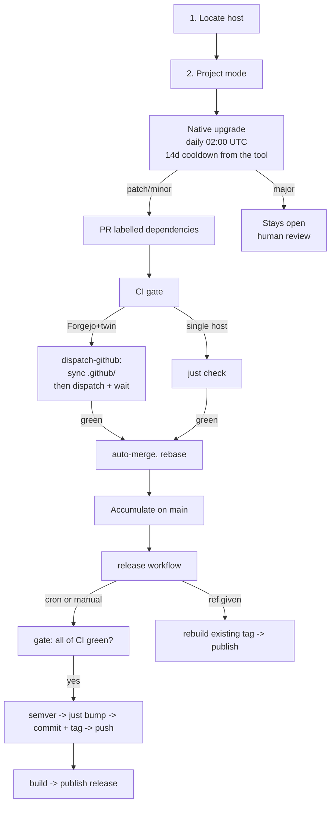

# Autonomous Upgrade

Pipeline: **native upgrade (daily + 14d cooldown) → CI gate → auto-rebase → `release` (gate all of CI → bump → tag → push → ship, one run)**.

Host model:

| Setup | Source of truth | Twin | Workflows live in |
|---|---|---|---|
| GitHub-hosted repo | `origin` on github.com | none | `.github/workflows/` |
| Self-hosted Forgejo, no twin | Forgejo origin | none | `.forgejo/workflows/` |
| Self-hosted Forgejo + GitHub twin | Forgejo origin | Throwaway public mirror, free runners only | `.forgejo/` + `.github/` (both authored here; see `hosts.md`) |

Never author in the twin: it is regenerated from the source `.github/` on
every dispatch, and hand edits are overwritten. Scan suppressions and pins
live in the source `.github/`.

## Do these three things first, in order

| # | Gate | Why it blocks everything after |
|---|---|---|
| 1 | **Locate the host** — `git remote -v` | Decides `.github/` vs `.forgejo/`, runner labels, `gh` vs native AGit, and whether a GitHub twin exists |
| 2 | **Ask the project mode** — maintenance or active | Decides whether `release.yml` gets `on.schedule` (active projects track milestones in an optional roadmap) |
| 3 | **Consult the owner** on the checklist in `references/decisions.md` | The rest are baselines to adapt, not mandates |

Never assume github.com. Never write a weekly cron for a project under active
development.

## Reference files

Read the file for the task at hand; do not read all four.

| File | Read when |
|---|---|
| `references/decisions.md` | The customization checklist — host, release model, artifacts, runner budget |
| `references/hosts.md` | Writing any workflow: GitHub vs Forgejo differences, the twin-repository pattern, branch protection |
| `references/ecosystems.md` | Setting the 14-day cooldown, or choosing whether an ecosystem qualifies at all |
| `references/workflows.md` | The four YAML templates: deps, CI, auto-merge, release |

## Hard rules

These are not negotiable. Rationale is in `references/decisions.md`.

1. **Consult the owner before applying.** No universal CI/CD flow. Record agreed
   choices and deviations in the PR/conversation — never a committed decision file.
2. **CI gate shape follows the host.** Single-host repos: one `just check`, no
   build matrix. Forgejo+twin repos: the CI workflow runs `just check` **plus
   the security scans in parallel** — Gitleaks (secrets), Semgrep (SAST),
   Trivy (OS packages + misconfigurations), OSV-Scanner (deps). Security
   scanning is a GitHub-runners-only concern: it runs on the twin, never on
   self-hosted Forgejo (no Docker images, no registry egress, no runner
   minutes there). Building artifacts is always the release workflow's job.
3. **14-day cooldown, enforced by the package manager itself.** Never re-implement
   the age filter as a shell script — the tool's own gate also covers transitive
   dependencies. If an ecosystem has no native gate, that project does not get
   autonomous bumps.
4. **Dependabot for GitHub Actions only.** On GitHub-hosted repos, Dependabot is
   used exclusively for `package-ecosystem: "github-actions"` to keep workflow
   actions up to date, and nothing else. Code dependencies are upgraded through
   native package managers (`bun update`, `cargo update`, `ncu`).
5. **Split patch/minor from major**, so a breaking major cannot block routine merges.
6. **Weekly releases only in maintenance mode.** Active development gets
   `workflow_dispatch` alone. The unified `release.yml` is one run: gate on
   all of CI, then semver → bump → commit + tag → push → build → publish.
   A `ref` input rebuilds an old tag; a `dry-run` checkbox previews the run.
7. **Cheapest single-core runner for orchestration** (`ubuntu-slim` on GitHub, the
   owner's self-hosted label on Forgejo). Full runners only for `just check` and
   artifact builds.
8. **Rebase-only, linear history.** No squash, no merge commits.
9. **Concurrency locks:** `release-main` (`cancel-in-progress: false`) for
   releases; dynamic per-branch `${{ github.workflow }}-${{ github.ref }}`
   (`cancel-in-progress: true`) for CI to safely cancel stale runs.
10. **Verify action runtimes match the runner.** `using: node24` actions fail on
    lean images like Alpine. Prefer shell-only composites on self-hosted runners.
11. **The release pushes straight to `main`; branch protection keeps safety
    rails only.** No required status checks (the release's own gate job calls
    all of CI, which is stronger than any single PR rule). Protection keeps:
    no force-push, no deletion, linear history. Push the bump commit first,
    then the tag — if the tag push fails, the next run recovers by tagging
    the existing commit. Never tag a commit whose manifest still carries the
    old version. Never ship a version that is not ahead of the latest tag.
12. **Self-owned action refs get `nosemgrep`, third-party refs get SHA pins.**
    The `github-actions-mutable-action-tag` rule fires on every `uses: …@<tag>`;
    on refs the owner controls on both ends (own Forgejo actions repo, own
    GitHub org) a tag can only be repointed by the owner, so suppress with a
    bare `# nosemgrep` comment (verified: the `rule-id` form is silently ignored
    on YAML `uses:` lines by current Semgrep). Third-party refs keep the rule
    live — pin them to full SHAs instead.
13. **No `${{ }}` interpolation inside `run:` blocks.** Move every workflow
   context value (`inputs.*`, `steps.*.outputs.*`, `needs.*.outputs.*`,
   `secrets.*`) into the step's `env:` block and reference `$VAR` in shell.
   `if:`/`with:`/`env:` interpolation is fine — the injection sink is the shell.
   Verified clean by scanning `run: |` blocks for `${{` before committing.
14. **Every `run:` step that uses `$VAR` declares `shell: bash`.** GitHub
   defaults `run:` to PowerShell/cmd on `windows-latest`, where `$VAR` expands
   to empty (verified: artefact shipped `error: target was empty` on the
   Windows matrix leg). `${{ }}` interpolation used to mask this because
   GitHub expands it pre-execution on every shell — rule 13 removes the mask,
   so the shell must be explicit. Single-platform Linux repos are unaffected
   but declare it anyway for copy-paste safety.

## Project contract

A repo qualifies only if all of these hold:

1. A root `justfile` with:
   - `check`: executes formatting, linting, tests, and static analysis.
   - `bump version`: updates the package manager's manifest (package-agnostic, see `references/ecosystems.md`).
2. Branch protection: safety rails only — no force-push, no deletion, linear history, and no required status checks (the release gates on all of CI itself).
3. The package manager has a native cooldown gate, configured to 14 days
   (see `references/ecosystems.md`).
4. The owner has stated the project mode.
5. Release artifacts are decided and implemented; CI stays build-free.
