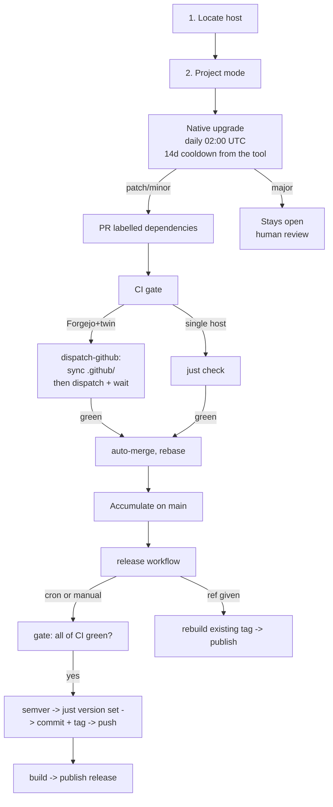

# CI/CD & Release Pipeline

Pipeline: **native upgrade (daily + 14d cooldown) → CI gate → auto-rebase → `release` (gate all of CI → version set → commit + tag → push → ship, one run)**.

Host model:

| Setup | Source of truth | Twin | Workflows live in |
|---|---|---|---|
| GitHub-hosted repo | `origin` on github.com | none | `.github/workflows/` |
| Self-hosted Forgejo, no twin | Forgejo origin | none | `.forgejo/workflows/` |
| Self-hosted Forgejo + GitHub twin | Forgejo origin | Throwaway public mirror, free runners only | `.forgejo/` + `.github/` (both authored here; see `hosts.md`) |

**FORBIDDEN: Never commit or push directly to the twin GitHub repository.** All
updates to the twin `.github/` workflows are automatically synchronized from
the source Forgejo repository by `git.delnegend.com/Delnegend/actions/dispatch-github`
on each Forgejo run. All changes belong strictly in the Forgejo source repository
(`.github/` and `.forgejo/`).

## Do these three things first, in order

| # | Gate | Why it blocks everything after |
|---|---|---|
| 1 | **Locate the host** — `git remote -v` | Decides `.github/` vs `.forgejo/`, runner labels, `gh` vs native AGit, and whether a GitHub twin exists |
| 2 | **Ask the project mode** — maintenance or active | Decides whether `release.yml` gets `on.schedule` (active projects track milestones in an optional roadmap) |
| 3 | **Consult the owner** on the checklist in `references/decisions.md` | The rest are baselines to adapt, not mandates |

Never assume github.com. Never write a weekly cron for a project under active
development.

## Reference files

Read the file for the task at hand; do not read all four.

| File | Read when |
|---|---|
| `references/decisions.md` | The customization checklist — host, release model, artifacts, runner budget |
| `references/hosts.md` | Writing any workflow: GitHub vs Forgejo differences, the twin-repository pattern, branch protection |
| `references/ecosystems.md` | Setting the 14-day cooldown, or choosing whether an ecosystem qualifies at all |
| `references/workflows.md` | The four YAML templates: deps, CI, auto-merge, release |

## Hard rules

These are not negotiable. Rationale is in `references/decisions.md`.

1. **Consult the owner before applying.** No universal CI/CD flow. Record agreed
   choices and deviations in the PR/conversation — never a committed decision file.
2. **CI gate shape follows the host.** Single-host repos: one `just check`, no
   build matrix, plus the shared scan workflow called as a job. Forgejo+twin
   repos: the CI workflow runs `just check` **plus those same scans in
   parallel**. Security scanning is a GitHub-runners-only concern: it runs on
   the twin, never on self-hosted Forgejo (no Docker images, no registry
   egress, no runner minutes there). Building artifacts is always the release
   workflow's job.
3. **Prefer shared actions over caller knobs.** Build, packaging, and publishing
   live in [Delnegend/actions](https://github.com/Delnegend/actions) pinned by SHA:
   `resolve-release` decides and performs the release, `package-artifact` names
   and uploads one archive (`<name>-<version>-<target>.<ext>`, always `dist/`),
   `publish-release` owns the release body, `docker-build-push` owns the image
   build. A per-repo `with:` input needs a recorded reason; the second caller
   needing the same input means it belongs in the shared default instead.
   Same for scans (rule 4): one shared configuration, `exclude` is the only knob.
4. **Scans come from the shared bundle, never hand-rolled.** Call
   `.github/workflows/scan.yml` pinned by SHA as a job. Do not write `docker run`
   scan jobs per project: they drift, and a shared gate is the only thing that
   keeps ten projects in agreement.
5. **14-day cooldown, enforced by the package manager itself.** Never re-implement
   the age filter as a shell script — the tool's own gate also covers transitive
   dependencies. If an ecosystem has no native gate, that project does not get
   autonomous bumps.
6. **Dependabot for GitHub Actions only.** On GitHub-hosted repos, Dependabot is
   used exclusively for `package-ecosystem: "github-actions"` to keep workflow
   actions up to date, and nothing else. Code dependencies are upgraded through
   native package managers (`bun update`, `cargo update`, `ncu`).
7. **Split patch/minor from major**, so a breaking major cannot block routine merges.
8. **Weekly releases only in maintenance mode.** Active development gets
   `workflow_dispatch` alone. The unified `release.yml` is one run: gate on
   all of CI, then semver → bump → commit + tag → push → build → publish.
   A `ref` input rebuilds an old tag; a `dry-run` checkbox previews the run.
9. **Cheapest single-core runner for orchestration** (`ubuntu-slim` on GitHub, the
   owner's self-hosted label on Forgejo). Full runners only for `just check` and
   artifact builds.
10. **Rebase-only, linear history.** No squash, no merge commits.
11. **Concurrency locks:** `release-main` (`cancel-in-progress: false`) for
   releases; dynamic per-branch `${{ github.workflow }}-${{ github.ref }}`
   (`cancel-in-progress: true`) for CI to safely cancel stale runs.
12. **Verify action runtimes match the runner.** `using: node24` actions fail on
   lean images like Alpine. Prefer shell-only composites on self-hosted runners.
13. **The release pushes straight to `main`; branch protection keeps safety
   rails only.** No required status checks (the release's own gate job calls
   all of CI, which is stronger than any single PR rule). Protection keeps:
   no force-push, no deletion, linear history. Push the bump commit first,
   then the tag — if the tag push fails, the next run recovers by tagging
   the existing commit. Never tag a commit whose manifest still carries the
   old version. Never ship a version that is not ahead of the latest tag.
14. **All GitHub Actions refs are pinned by immutable SHA (`@<sha> # v1`).**
    Never use mutable tags on GitHub; SHA pins require no `# nosemgrep` comments.
    On self-hosted Forgejo runners where internal actions use version tags (e.g.
    `https://git.delnegend.com/Delnegend/actions/...@v6`), suppress Semgrep's
    mutable-tag rule with a trailing `# nosemgrep`.
15. **No `${{ }}` interpolation inside `run:` blocks.** Move every workflow
   context value (`inputs.*`, `steps.*.outputs.*`, `needs.*.outputs.*`,
   `secrets.*`) into the step's `env:` block and reference `$VAR` in shell.
   `if:`/`with:`/`env:` interpolation is fine — the injection sink is the shell.
   Verified clean by scanning `run: |` blocks for `${{` before committing.
16. **Every `run:` step that uses `$VAR` declares `shell: bash`.** GitHub
   defaults `run:` to PowerShell/cmd on `windows-latest`, where `$VAR` expands
   to empty (verified: artefact shipped `error: target was empty` on the
   Windows matrix leg). `${{ }}` interpolation used to mask this because
   GitHub expands it pre-execution on every shell — rule 13 removes the mask,
   so the shell must be explicit. Single-platform Linux repos are unaffected
   but declare it anyway for copy-paste safety.
17. **Never commit or push directly to the twin repository.** All commits and pushes
    go strictly to the Forgejo source repository. The twin mirror on GitHub is
    automatically updated by `git.delnegend.com/Delnegend/actions/dispatch-github`.
    Pushing to the twin directly will cause conflicts and will be overwritten.
18. **Standardize on `just version get` and `just version set <ver>`.** No top-level
    `bump` recipe alias and no per-language version parsing in release workflows.
    `version get` prints `X.Y.Z` (no `v`); `version set` rewrites manifest(s) to
    the new version without committing or tagging.

## Project contract

A repo qualifies only if all of these hold:

1. A hidden root `.justfile` with:
   - `check`: the single CI gate. Assert-only — format check, lint, vet, tests.
     Never rewrites the tree (`cargo fmt --check` not `cargo fmt`, `gofmt -l`
     not `go fmt`); a check that dirties the checkout is a bug.
   - `version get` / `version set <ver>`: the release action's version contract.
     `get` prints `X.Y.Z`; `set` rewrites the manifests, no commit, no tag.
2. Branch protection: safety rails only — no force-push, no deletion, linear history, and no required status checks (the release gates on all of CI itself).
