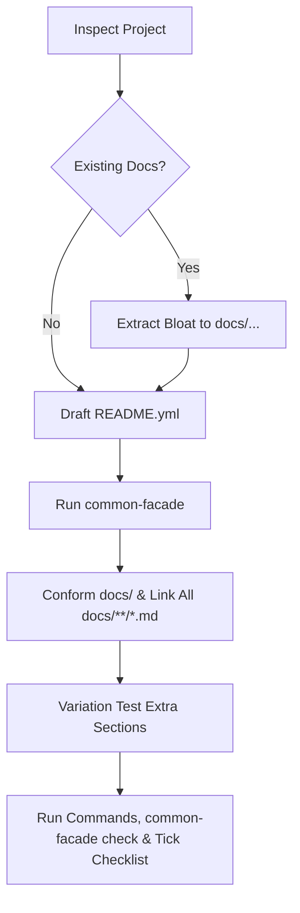

# Docs Skill

A project's `README.md` is a **high-conversion landing page**, not an exhaustive manual. Across maintained repositories, root `README.md` and `LICENSE*` files are generated and validated from `README.yml` using [`common-facade`](https://github.com/Delnegend/common-facade) (enforced in CI by `Delnegend/actions/.github/workflows/scan.yml`). Everything beyond the 60-second landing page lives in `docs/`, following one shared shape so every project reads the same way and differs only where the project genuinely differs.

## Triggers

- Slash commands: `/docs`, `/docs-template`, `/init-docs`
- Natural language: "create a readme", "standardize the readme", "standardize docs", "clean up the docs", "make a minimal readme"

## Workflow

1. **Inspect project**: identify project type (CLI binary, container/service, library, dotfiles), package manager, primary binary or formula name, and whether the repo uses `common-facade` (default for all maintained repos calling `scan.yml`; hand-authored `README.md` is only for non-facade exceptions like `dotfiles`, `homebrew-tap`, or `Delnegend/actions`).
2. **Audit or Extract**: if existing docs are bloated:
   - Keep in `README.yml`: one-sentence tagline, sub-60s `quick_start`, 3-5 outcome `highlights`, and the `documentation` links.
   - Extract to `docs/`: configuration tables, architecture diagrams and invariants, deployment steps, and contributor prerequisites.
3. **Author `README.yml` and generate**: apply `references/template.md` (`README.yml` with `$schema: "https://raw.githubusercontent.com/Delnegend/common-facade/main/README.schema.json"`). Run `common-facade` to generate `README.md` and `LICENSE*`. Never hand-edit generated `README.md` or `LICENSE*`.
4. **Conform `docs/`**: bring `docs/architecture.md`, `docs/deployment.md`, and `docs/development.md` onto `references/docs-layout.md` (constraints + skeleton each): trim to the caps, keep project-specific facts, replace restated shared-workflow semantics with a link.
5. **Link every `docs/**/*.md` file**: `scan.yml`'s `docs-references` job fails if any Markdown file under `docs/` is not linked in `README.md`. Reference extra guides (such as `docs/configuration.md` or `docs/cli.md`) inline inside `documentation` descriptions or `quick_start` in `README.yml`, then re-run `common-facade`.
6. **Variation test**: for every extra section or extra file under `docs/`: it stays only if copying it into another project would make no sense.
7. **Verify**: run every Quick Start and Prerequisites command fresh, run `common-facade check`, confirm zero em dashes in tracked files, resolve every link locally, and tick the quality checklist in `references/docs-layout.md`. Nothing ships with an unticked box.

## Reference Files

Read the relevant file for the active task; do not load both:

| File                        | Purpose                                                                                                                                                                         |
| --------------------------- | ------------------------------------------------------------------------------------------------------------------------------------------------------------------------------- |
| `references/template.md`    | The `common-facade` `README.yml` template (primary), install ladder, customization guidelines, and fallback hand-authored `README.md` template.                                 |
| `references/docs-layout.md` | Directory layout, per-file constraints and skeletons (`configuration.md`, `architecture.md`, `deployment.md`, `development.md`), the variation test, and the quality checklist. |

## Hard Rules

1. **`README.yml` is the source of truth (never hand-edit generated files):** Maintained repos author `README.yml` and run `common-facade` to produce `README.md` and `LICENSE*`. `common-facade` enforces a strict 4-section root README (`Quick Start`, `Highlights`, `Documentation`, `License`): do not add `Common Options`, `Architecture`, or `Roadmap` sections to root `README.md`.
2. **Concise caps:** Generated root `README.md` stays under 100 lines; `docs/architecture.md`, `docs/deployment.md`, and `docs/development.md` each stay under 120 lines. One concern per file; merge overlapping files instead of growing them.
3. **One-sentence value proposition:** `tagline` states in plain language what the project is, who it is for, and the outcome it delivers. No jargon.
4. **Badges via `badgers.space` (`corner_radius=0`):** Standard `ci`, `release`, and `license` badges are generated automatically by `common-facade` from `badges:` in `README.yml`. Any `custom` badge (or hand-authored fallback) also uses `badgers.space`, never `img.shields.io`. Keep badges to 3-5 on one line.
5. **Sub-60s Quick Start:** 3 steps max: Install -> Run -> Verify. Copy-paste ready with zero hidden prerequisites.
6. **Brew-primary install:** On Linux and macOS the install step is `brew install <owner>/tap/<formula>`. No formula -> latest-release asset lookup (never a pinned version). Source builds (`cargo install`, `go install`, `go build`) are the last resort, never step 1.
7. **Outcome-focused highlights:** 3-5 bullet points stating user outcomes (speed, safety, ease), never implementation trivia (e.g. "Uses Tokio 1.2" is forbidden).
8. **Every `docs/**/*.md` file must be linked in `README.md`:** Enforced by `scan.yml`'s `docs-references` job. Beyond the three required `documentation` slots (`architecture`, `development`, `deployment`), link any additional `docs/*.md` guide inline in a slot's description or in `quick_start`.
9. **No configuration dumps or ASCII art:** Configuration tables belong in `docs/configuration.md`; architecture diagrams use Mermaid in `docs/architecture.md`. Never use ASCII art.
10. **Link shared machinery, never restate it:** Release dispatch modes, version calculation, and archive naming are defined once in `Delnegend/actions`. Project docs state project-specific facts (what it builds, what each archive holds) and link out for the rest.
11. **Variation test for every extra section:** A section or extra doc not in the template stays only if copying it into another project would be nonsense.
12. **Zero placeholder debt and zero em dashes:** Never leave `TODO`, `WIP`, or empty sections in published docs. Never use em dashes in tracked files (`scan.yml`'s `emdash` job fails CI on them); use colons, parentheses, or hyphens instead.
