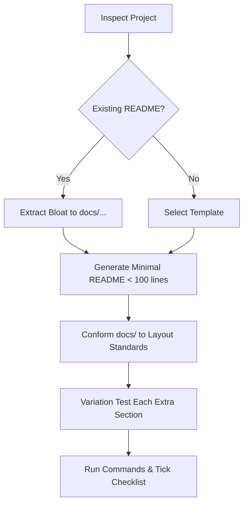

# Docs Skill

A project's `README.md` is a **high-conversion landing page**, not an exhaustive manual. It tells the reader what the project does and gives them working commands in under 60 seconds. Everything else belongs in `docs/` — and `docs/` itself follows one shared shape, so every maintained project reads the same way and differs only where the project genuinely differs.

## Triggers

- Slash commands: `/docs`, `/docs-template`, `/init-docs`
- Natural language: "create a readme", "standardize the readme", "standardize docs", "clean up the docs", "make a minimal readme"

## Workflow

1. **Inspect project** — identify project type (CLI binary, web service, library, dotfiles), package manager, build command, primary binary name, and Homebrew formula name if one exists.
2. **Audit or Extract** — if a `README.md` already exists:
   - Keep: the one-sentence purpose, 3-step quickstart, and primary flags.
   - Extract to `docs/`: configuration tables with more than 5 rows, deep architectural essays, deployment scripts, or long contributing steps.
3. **Generate root `README.md`** — apply `references/template.md`. Keep total length under 100 lines. Quick Start installs via the Homebrew tap first; see the template's install ladder.
4. **Conform `docs/`** — bring `docs/architecture.md`, `docs/deployment.md` and `docs/development.md` onto `references/docs-layout.md` (constraints + skeleton each): trim to the caps, keep project-specific facts, replace restated shared-workflow semantics with a link.
5. **Variation test** — for every section not in the template: it stays only if it would make no sense copied into another project. A Proton/Wine bridging guide stays (nothing else bridges); a second install method goes.
6. **Verify** — run every command in Quick Start and Prerequisites fresh, resolve every link locally, and tick the quality checklist in `references/docs-layout.md`. Nothing ships with an unticked box.

## Reference Files

Read the relevant file for the active task; do not load both:

| File | Purpose |
|---|---|
| `references/template.md` | The universal golden template for root `README.md` files (covers 99% of use cases), including the install ladder. |
| `references/docs-layout.md` | Directory layout, per-file constraints and skeletons (`configuration.md`, `architecture.md`, `deployment.md`, `development.md`), the variation test, and the quality checklist. |

## Hard Rules

1. **Max 100 lines for root `README.md`:** If the file exceeds 120 lines, you are writing manual pages instead of a landing page. Offload immediately.
2. **Max 120 lines per guide:** `architecture.md`, `deployment.md` and `development.md` each stay under 120 lines. One concern per file; merge overlapping files instead of growing them.
3. **One-sentence value proposition:** The first sentence under the header must state in plain language what the project is, who it is for, and the outcome it delivers. No jargon.
4. **Max 3–5 badges on one line:** Only functional badges (CI status, latest release tag, license). Never allow badge lines to wrap.
5. **Sub-60s Quick Start:** Exactly 3 steps max: Install → Run → Verify. Commands must be copy-paste ready with zero hidden prerequisites.
6. **Brew-primary install:** On Linux and macOS the install step is `brew install <owner>/tap/<formula>`. No formula → latest-release asset lookup (never a pinned version). Source builds (`cargo install`, `go install`, `go build`) are the last resort, never step 1.
7. **Outcome-focused highlights:** Exactly 3–5 bullet points. State user outcomes (speed, safety, ease), never implementation trivia (e.g. "Uses Tokio 1.2" is forbidden).
8. **No configuration dumps:** Never place more than 5 CLI flags or environment variables in `README.md`. More than 5 items MUST live in `docs/configuration.md`.
9. **No deep architecture treatises & use Mermaid:** Root architecture gets a compact Mermaid diagram or 2 sentences max. Never use ASCII art. Deep explanations belong in `docs/architecture.md`.
10. **Link shared machinery, never restate it:** Release dispatch modes, version calculation, and archive naming are defined once in Delnegend/actions. Project docs state the project-specific facts (what it builds, what each archive holds) and link out for the rest.
11. **Variation test for every extra section:** A section not in the template stays only if copying it into another project would be nonsense. Domain sections that pass (a dedicated bridge guide, a decoder's benchmark section) are the model; generic seconds of anything are not.
12. **No placeholder debt & clean roadmap:** Never leave `TODO`, `WIP`, or empty sections in published docs. In-flight work for active projects belongs in an optional `## Roadmap` checklist (max 3–5 items), never in scattered scratch files. Omit the section once in maintenance mode.
