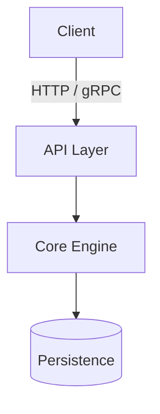

# `docs/` Offloading Standards & Skeletons

Offload anything beyond the 60-second landing page to dedicated files inside `docs/`. This keeps `README.md` under 100 lines and isolates changes to specific docs.

## File Map

| File | Read/Write when |
|---|---|
| `docs/configuration.md` | Configuration flags, environment variables, full YAML/JSON/TOML schema, defaults. |
| `docs/architecture.md` | Module boundaries, state machines, networking protocols, design tradeoffs. |
| `docs/deployment.md` | Installation via the tap, services, logs, upgrades. |
| `docs/development.md` | Prerequisites, toolchains, building from source, running tests, linters. |

Release dispatch modes, version calculation and archive naming are **not**
documented here beyond one link: they are defined once in
[Delnegend/actions](https://github.com/Delnegend/actions/blob/main/README.md)
(full reference in
[docs/configuration.md](https://github.com/Delnegend/actions/blob/main/docs/configuration.md)).
Project docs state only the project-specific facts — what it builds, what each
archive holds, any installer of its own — and link out for the rest.

---

## The Variation Test

A section not in the skeletons below stays only if copying it into another
project would be nonsense. This is the whole rule for project-specific docs:

- **Stays:** a Proton/Wine bridging guide (no other project bridges), a
  decoder's benchmark section (performance is that project's definition).
- **Goes:** a second install method, a restated dispatch-mode table, a generic
  "troubleshooting" list that fits any CLI.

When two projects need the same section, the section belongs in the shared
template or the shared action's docs — not in both projects.

---

## Quality Checklist

Tick every box before the docs ship. An unticked box is a defect, not a note.

- [ ] Root `README.md` under 100 lines; each guide under 120 lines.
- [ ] Quick Start follows the install ladder (brew tap primary), runs in under
  60 seconds, and every command was executed fresh during this pass.
- [ ] `development.md` opens with Prerequisites: exact toolchain and versions,
  `just`, and any OS-specific notes. No hidden prerequisites anywhere else.
- [ ] No pinned versions in install commands; no `TODO`/`WIP`/empty sections.
- [ ] Shared-workflow semantics appear exactly once per repo, as a link.
- [ ] Every non-template section passes the variation test above.
- [ ] Every link resolves; every badge renders.

---

## 1. `docs/configuration.md`

Use when the project has more than 5 configuration options, environment variables, or nested config files.

````markdown
# Configuration Reference

## Environment Variables

| Variable | Default | Required | Description |
|---|---|---|---|
| `PORT` | `8080` | No | Port for the HTTP service |
| `DATABASE_URL` | None | Yes | PostgreSQL connection string |
| `LOG_LEVEL` | `info` | No | Logging level: `debug`, `info`, `warn`, `error` |

## Configuration File

The project loads `config.yaml` by default. Example:

```yaml
server:
  host: 0.0.0.0
  port: 8080

storage:
  path: /var/lib/app/data
  sync_interval_seconds: 60
```

## Options Matrix

| Key | Type | Default | Description |
|---|---|---|---|
| `server.host` | string | `0.0.0.0` | Bind IP address |
| `server.port` | integer | `8080` | Bind TCP port |
````

---

## 2. `docs/architecture.md`

Use when documenting system design, data flows, invariants, or component boundaries.

Constraints: under 120 lines. Overview in 2–4 sentences, one Mermaid diagram,
3–6 component bullets, 2–5 invariants. Every section must explain a decision a
reader cannot get from reading the code — no file listings, no symbol
inventories. Extra sections take the variation test.

````markdown
# Architecture

## Overview

High-level description of how components interact and what guarantees the system maintains.



## Core Components

- **API Layer:** Handles authentication, rate limiting, and request validation.
- **Core Engine:** Executes domain logic and state transitions without IO dependencies.
- **Persistence:** Manages atomic updates to storage and cache.

## Invariants & Guarantees

- **Crash-consistency:** All state changes commit to disk before answering the client.
- **Idempotency:** Re-running a command with the same request ID causes no side effects.
````

---

## 3. `docs/deployment.md`

Use for installation, services, logs and upgrades on the user's machine.

Constraints: under 120 lines. Install via the Homebrew tap first; platform
extras (udev rules, service registration, drivers) as numbered steps after it.
Then: run as a service, read the logs, upgrade. One page per deployment
target at most; per-platform quirks that serve one project (an MSI installer,
a kernel driver) take the variation test instead of becoming template.

````markdown
# Deployment & Operations

## Install

```bash
brew install <owner>/tap/<project>
```

Platform extras, if any, as numbered steps (udev rules, service
registration, drivers).

## Run as a Service

```bash
brew services start <project>
tail -f /tmp/<project>.log
```

## Upgrade

```bash
brew upgrade <project>
```
````

---

## 4. `docs/development.md`

Use when describing contributor prerequisites, build steps, test suites, and linting.

Constraints: under 120 lines. Opens with Prerequisites (exact toolchain and
versions, `just`, OS notes) — a build that needs something unlisted is a doc
bug. Build & test through the repo's gate command (`just check` or
equivalent). Release procedure is one link to Delnegend/actions plus the
repo's bump command, never a restated pipeline.

````markdown
# Development Guide

## Prerequisites

- Required language toolchain (e.g. Go 1.23+, Rust 1.80+, Node.js 22+)
- `just` task runner

## Build & Test

```bash
# Install dependencies and compile
just build

# Run unit and integration tests
just test

# Format and lint
just check
```

## Contribution Workflow

1. Branch off `main`: `git checkout -b feat/my-feature`.
2. Ensure `just check` passes cleanly.
3. Open a PR with clear user outcome in the description.
````
